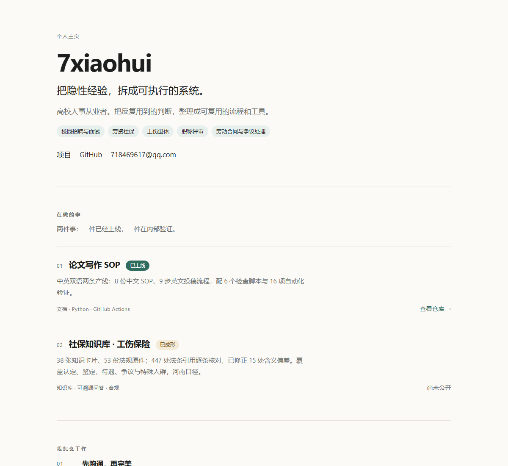
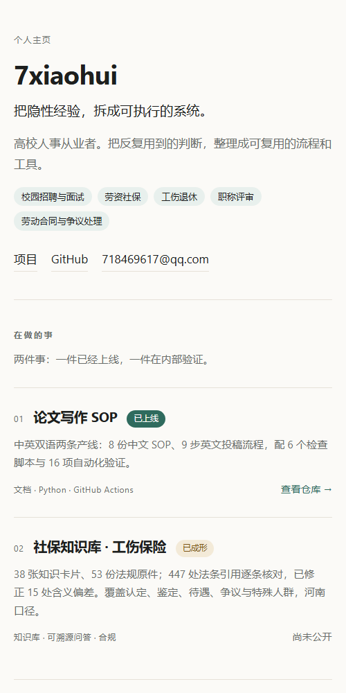

<div align="center">

<h1>7xiaohui</h1>

<p><strong>把隐性经验，拆成可执行的系统。</strong></p>

<p>高校人事从业者 · 校园招聘 / 劳资社保 / 工伤退休 / 职称评审 / 劳动合同与争议</p>

<p>
  <a href="https://7xiaohui.github.io/">在线预览</a> ·
  <a href="https://github.com/7xiaohui/paper-writing-sop">论文写作 SOP</a> ·
  <a href="mailto:718469617@qq.com">Email</a>
</p>

</div>



## 这是什么

个人主页的源码：一页纯静态 HTML / CSS，没有框架、没有外链字体、没有统计脚本。

- **纯静态**：打开 `index.html` 就能看，不依赖任何服务；
- **无外链资源**：字体用系统字体，国内访问不依赖 CDN；
- **深色模式**：跟随系统设置；
- **可读优先**：桌面限宽 980px，手机自适应，正文不超过 72 字宽。

## 页面内容

| 模块 | 内容 |
|---|---|
| 顶部 | 一句话定位 + 专业领域标签 |
| 在做的事 | 论文写作 SOP（已上线）｜社保知识库 · 工伤保险（已成形，尚未公开） |
| 我怎么工作 | 先跑通再完美 / 判据优先 / 能脚本化的不靠肉眼 |
| 关于 | 职业背景与做这些事的原因 |

## 项目

- **[论文写作 SOP](https://github.com/7xiaohui/paper-writing-sop)** —— 中英双语两条产线，8 份中文 SOP、9 步英文流程、6 个检查脚本、16 项自动化验证；
- **社保知识库 · 工伤保险** —— 38 张知识卡片、53 份法规原件、447 处法条引用逐条核对；目前未公开。

<details>
<summary>手机端预览</summary>



</details>

## 本地预览

```powershell
# 直接双击 index.html，或
python -m http.server 8000
# http://localhost:8000
```

## 结构

```
index.html            页面内容
assets/style.css      样式（含深色模式）
assets/favicon.svg    站点图标
docs/                 README 预览图
```

## 说明

- 页面不加载任何第三方脚本、字体或统计工具；
- 邮箱为公开联系方式，可能收到推广邮件；
- 预览图是页面截图，页面更新后需要重新截取。

---

<p align="center"><sub>© 2026 7xiaohui · Built with plain HTML &amp; CSS</sub></p>
